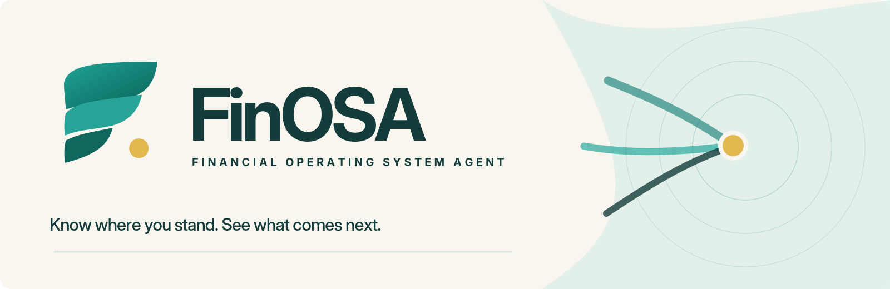
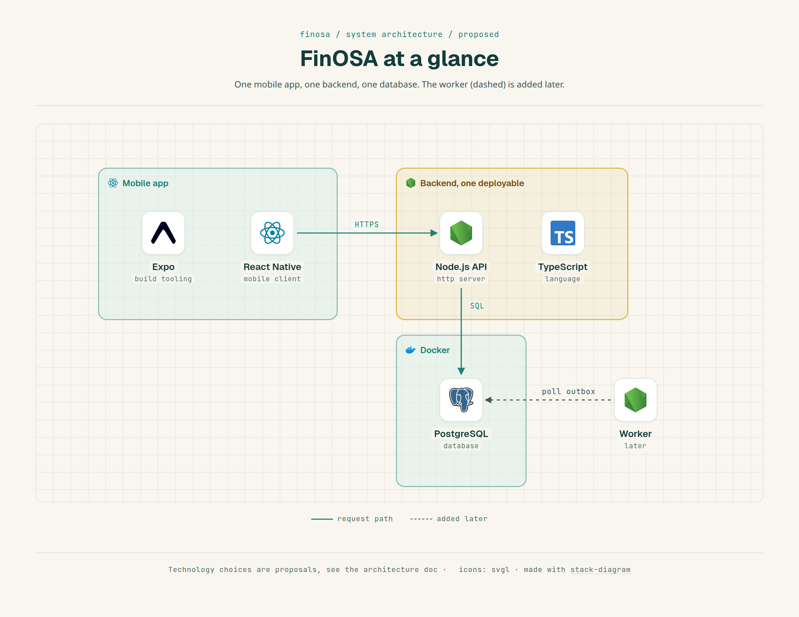

  

<h1 align="center">FinOSA</h1>

  <strong>Know where you stand. See what comes next.</strong> 
  Financial Operating System Agent: a personal-finance project built around numbers you can check.

  
  

## Why FinOSA

Balances sit in one app, transactions in another, subscriptions in memory, goals in someone's head. A list of transactions does not explain any of it, and automated tools rarely show where a number came from.

FinOSA aims to pull that into one picture: what happened, why it matters, what is likely next, and what is safe to do. Every figure is traceable to the records behind it.

## Principles

- **Computed, not generated.** Balances, totals and rules come from tested code. An AI feature may explain a number. It never invents one.
- **Privacy by default.** Collect the minimum, keep sensitive content out of logs, and let users delete their data.
- **Corrections keep history.** Fixing a mistake never erases what was recorded before, so past totals stay explainable.
- **Grow step by step.** Start with one backend and plain, visible code. Add automation and event-driven parts only when a real need appears.

## Architecture

  

One mobile app, one backend and one database to begin with. Built with TypeScript, Prisma, Zod and npm workspaces. The [System Architecture](docs/03-system-architecture.md) doc has the details and the reasons behind each choice.

## Status

Design stage: there is no code yet, and nothing here is financial advice. The first version is planned as a local foundation using made-up data. Do not use real financial data with this project.

## Documentation

1. [Product Vision](docs/01-product-vision.md): the problem, who it is for, and what FinOSA is not
2. [Product Requirements](docs/02-product-requirements.md): scope, user journeys and testable requirements
3. [System Architecture](docs/03-system-architecture.md): components, boundaries and technology choices
4. [Domain Model and Data Design](docs/04-domain-model.md): the meaning of financial terms and the data rules
5. [Event-Driven Design](docs/05-event-driven-design.md): how events and reliable delivery will be introduced
6. [Development and Learning Roadmap](docs/06-development-roadmap.md): milestones and what each one teaches

New to a term? See the [glossary](docs/glossary.md). Logos, colors and brand guidelines are in [assets/brand](assets/brand).

## Contributing

There is no code to contribute to yet. Questions and feedback on the design are welcome as GitHub issues. Please never post real financial data, account numbers or statements.

## License

[MIT](LICENSE)

 

   
  FinOSA &middot; From transactions to understanding.

