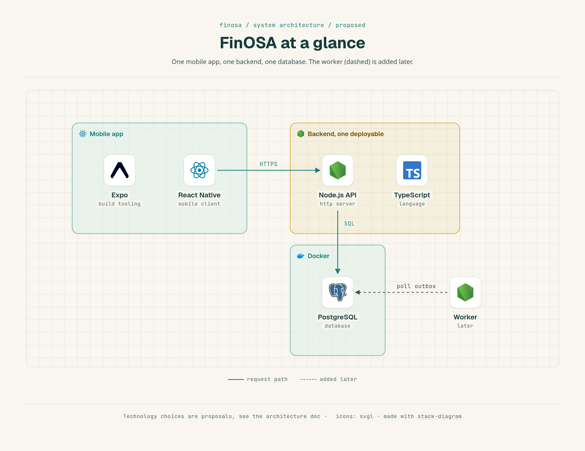
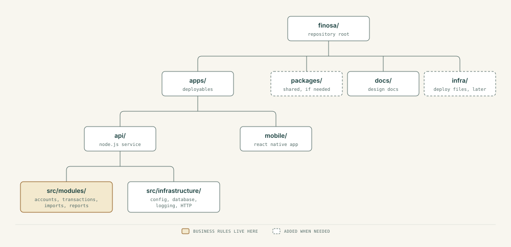
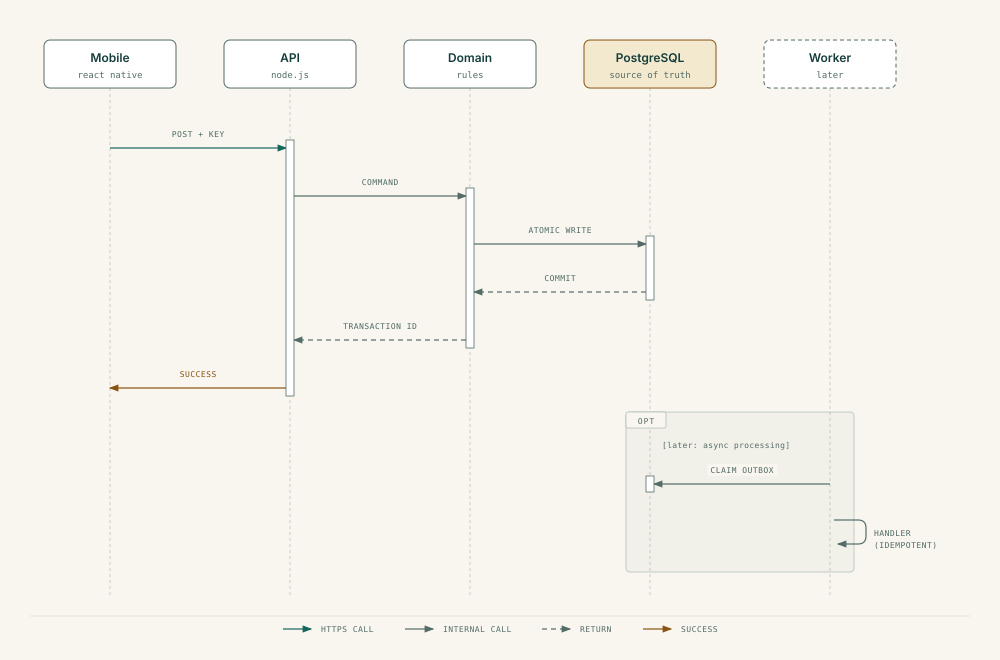

# System Architecture

Status: design decisions recorded; nothing is implemented yet. Components marked "later" do not exist in the initial scaffold.

## 1. Overview

Start as a modular monolith: one deployable backend, one mobile app, one relational database, with explicit boundaries between application, domain and persistence code. Use events for changes that have independent downstream reactions. Do not use them in place of ordinary function calls.

  

Essential user-facing writes are synchronous. Heavier reactions become asynchronous once durable event delivery exists.

## 2. Units and responsibilities

| Unit | Starts with | Owns | Does not own |
|---|---|---|---|
| Mobile app | React Native with Expo | UI, input validation, navigation | The ledger as source of truth |
| API service | Node.js + TypeScript on plain `node:http`, with small supporting libraries such as Zod | Auth boundary, orchestration, validation, domain actions | Long-running AI or background jobs |
| PostgreSQL | Local Docker database | Durable account and transaction state | Business decisions |
| Worker (later) | Node.js + TypeScript | Async processing, event delivery | Primary request validation |
| Message broker (optional, later) | RabbitMQ or Kafka, to be evaluated | Durable transport and routing | Authoritative financial data |

The API uses Node's built-in `node:http` module instead of an application framework, so routing, body parsing and the request lifecycle stay visible. Small libraries are fine; NestJS is not used. Zod (a validation library) checks incoming JSON at runtime, because TypeScript types disappear when the program runs.

## 3. Suggested repository layout

  

Create a directory only when it holds real code. The API is organised by feature first: each module owns its own rules and exposes a narrow interface, so other modules do not reach into its tables. Modules planned for v0.1 are accounts, transactions, imports and reports. Auth, users, budgets and insights come later. `packages/financial-core` is created only if pure money logic must be shared between the API and the mobile app.

### Layers inside a module

Each feature keeps its layers together (for example `transaction.routes.ts`, `.controller.ts`, `.service.ts`, `.repository.ts`, `.schemas.ts`, `.test.ts`):

| Layer | Responsibility |
|---|---|
| Routes | Match an HTTP method and URL, such as `GET /api/v1/transactions` |
| Middleware | Common request work: authentication, logging, correlation IDs |
| Controllers | Translate an HTTP request into a service call and a response. No calculations or SQL |
| Services | Business workflows and rules. Usable without HTTP, including from a background worker |
| Repositories | All database access through Prisma, behind an interface so services can be tested with fakes |
| Integrations | Isolate outside systems such as a financial-data source or an AI provider |
| Domain | Financial concepts and rules: money, transactions, balances |

`app.ts` assembles repositories, services and controllers (the composition root: the one place where parts are wired together, passed in as constructor or factory arguments). `server.ts` only starts the network listener. Keeping them apart lets tests build the app without opening a port.

## 4. Request flow

For `POST /transactions`:

1. The app sends an authenticated request with a client-generated idempotency key.
2. The HTTP layer validates the request shape and the user's identity.
3. The application service checks account ownership and runs the domain operation.
4. The persistence layer writes all required records in one database transaction.
5. After commit, the API returns the stable transaction ID.
6. Later: the same database transaction also writes an outbox record, which a worker delivers asynchronously.

  

## 5. Command, query, event

- **Command:** a request to do something, such as `RecordTransaction`. It can fail and needs authorization and invariant checks.
- **Query:** a read, such as monthly spending. Initially it reads directly from the authoritative tables.
- **Event:** a past fact, such as `transaction.recorded.v1`. It is not an instruction to any particular consumer.

Avoid turning an in-process method call into a broker message, or delaying a required write for the sake of architectural purity.

## 6. Data consistency

- PostgreSQL is the source of truth for accounts and posted transactions.
- At MVP scale, prefer synchronous reads from authoritative tables.
- Derived projections updated asynchronously are eventually consistent: they may lag the latest write.
- Provide reconciliation and rebuild tools before relying on any projection.
- Once the outbox exists, the transaction write and the outbox insert are atomic.

## 7. Authentication and security

Design security before collecting real data.

- Scope every account and transaction query to the authenticated user.
- v0.1 runs locally with one built-in test user behind a non-public API. That is not a substitute for authentication on an internet-facing service, so real login is a separate milestone before any real data or hosting.
- Check authorization in application and persistence code, not only by hiding mobile screens.
- Rate-limit exposed endpoints, require TLS, and store session tokens in secure device storage.
- Never log full bank descriptions, credentials, statement files or secrets.
- Restrict database credentials and network exposure.

Choose between tokens and server sessions in the login milestone, before any public deployment.

## 8. Operations

**Start small:** a health endpoint, structured logs with correlation IDs, a migration workflow, integration tests against PostgreSQL, one-command local setup.

**When events arrive:** trace IDs across producers and consumers, outbox backlog and age, retry counts, redacted failure reasons, projection lag, alerts on stuck processing.

**Deployment path:** local processes, then Docker Compose, then one hosted API and database, then an optional separate worker, then Kubernetes as a learning milestone rather than an MVP requirement.

## 9. Technology decisions

| Decision | Position | Reason |
|---|---|---|
| Node.js + TypeScript backend | Established | One language across backend and mobile; visible runtime behavior |
| React Native with Expo | Chosen | React Native's own docs recommend starting with a framework such as Expo; it handles phone build setup |
| NestJS | Not the default | Keep wiring and the request lifecycle visible |
| PostgreSQL | Chosen | Transactions, constraints, migrations |
| Plain `node:http` + Zod | Chosen | Visible request lifecycle; runtime validation at the boundary |
| Prisma ORM, pinned to 7.x | Chosen | Typed data access and managed migrations. The version 8 release candidate is not used until it is stable. Database rules such as `CHECK (amount_minor > 0)` are added by hand-editing the generated migration SQL |
| npm workspaces | Chosen | Ships with Node.js; no extra tool to learn |
| Fonts: Petrona and Familjen Grotesk, via `@expo-google-fonts` | Chosen | Distinctive pair that both include the rupee sign and open-licensed. Familjen Grotesk's digits align by default. Petrona needs tabular numerals switched on for any number. Details in the [brand guidelines](../assets/brand/BRAND_GUIDELINES.md) |
| Broker | Deferred (M8) | Choose when consumer delivery needs are shown |
| Kubernetes | Deferred | Learn once deployments and worker scaling exist |

## 10. Checkpoints before adding a module or service

1. Which business capability does it own?
2. Is this a synchronous invariant or an asynchronous reaction?
3. Which data is authoritative?
4. What happens on a timeout, crash or repeated request?
5. How is it tested and observed?
6. Could it be a function call instead of a distributed message?

## 11. Planned ADRs

Write each when the decision is made.

- `0001-modular-monolith.md`
- `0002-http-layer.md`
- `0003-money-representation.md`
- `0004-transactional-outbox.md`
- `0005-event-transport.md`
