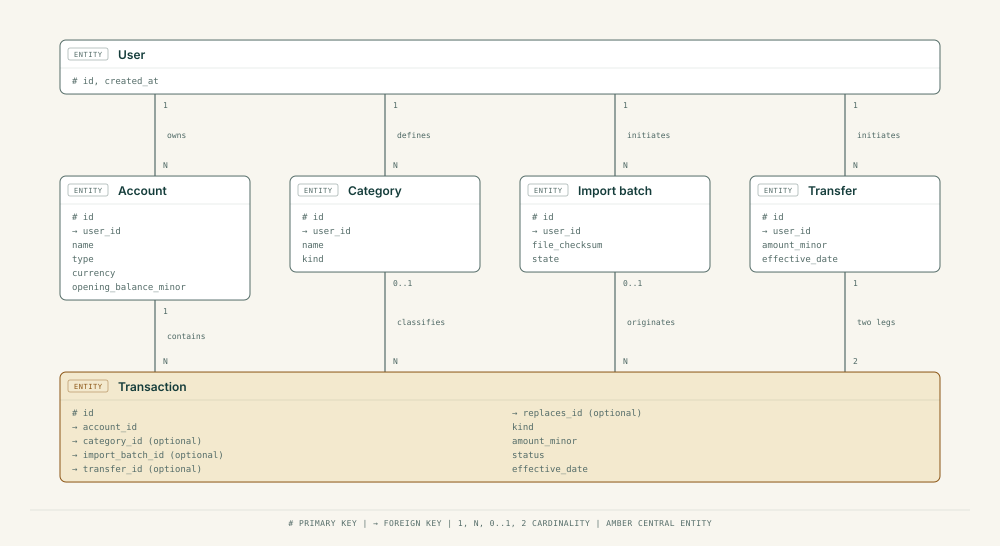

<div align="center">

# Domain Model and Data Design

Status: conceptual model. It fixes the meaning of financial terms before any SQL schema is committed.

</div>

## 1. Purpose

Financial bugs usually begin with ambiguous concepts. Is a transfer an expense? Does a pending charge reduce the balance? What does it mean to import the same transaction twice? Settle the language first, then design tables.

## 2. Glossary

| Term | Meaning in FinOSA |
|---|---|
| **User** | The person who owns private account and transaction data |
| **Account** | A user-defined holder of money: bank account, wallet, cash |
| **Transaction** | A recorded money movement or observation, with source and status |
| **Income** | Money entering an owned account from outside |
| **Expense** | Money leaving owned accounts to an outside party |
| **Transfer** | Money moving between two owned accounts. Not income or expense |
| **Opening balance** | A starting amount with a known effective date |
| **Posted** | Confirmed, and included in derived balances and reports |
| **Pending** | Not yet confirmed; excluded from MVP balances |
| **Category** | A user-editable label for income or expenses |
| **Import batch** | One upload attempt, with its parsing and review details |
| **Source reference** | An identifier supplied by the user's data source, if any |
| **Idempotency key** | A client-supplied token that lets the server recognize a repeated command |

## 3. Invariants

1. A transaction's amount is non-negative. Its kind says which way it moves the balance. Never mix negative amounts with a separate direction field without one canonical rule.
2. Money is an amount plus an ISO currency code. v0.1 supports INR only, and the currency is still stored. Amounts are whole paise in 64-bit integers: `BIGINT` in the database, `bigint` in code, text in JSON.
3. A user cannot read or change another user's accounts or transactions.
4. A transfer produces two equal and opposite effects in the same currency, written atomically. Total money across owned accounts is unchanged.
5. `posted` and `pending` have explicit reporting rules. v0.1 uses posted only.
6. Duplicate detection is conservative. A likely match is flagged for review and never silently deleted, unless a strong import-batch identity rule applies.
7. Monthly and category totals can be reproduced from authoritative records.
8. Event handlers cannot apply a financial effect twice on replay.
9. Corrections keep their history. Changing an amount, date or account voids the original and adds a replacement. Posted transactions are never hard-deleted.

## 4. Concepts and relationships

<p align="center">
  
</p>

This is a conceptual diagram. A transfer is modeled as exactly two linked transaction legs, enforced by application logic and database constraints, not by the diagram's cardinality.

## 5. Candidate fields

**`users`**
- `id` (UUID), `created_at`, `updated_at`
- Authentication identity references, chosen after the auth decision

**`accounts`**
- `id`, `user_id`
- `name`, `type` (`bank`, `wallet`, `cash`, `other`)
- `currency` (initially `INR`)
- `opening_balance_minor`, `opening_balance_date`
- `created_at`, `updated_at`, `archived_at` (optional)

**`transactions`**
- `id`, `user_id`, `account_id`
- `kind` (`income`, `expense`, `transfer_in`, `transfer_out`)
- `amount_minor` (positive integer), `currency`
- `status` (`posted`, `pending`, `voided`)
- `effective_date` (calendar date), `created_at`, `updated_at`
- `description`, `merchant` (sensitive, optional)
- `category_id` (nullable), `import_batch_id` (nullable)
- `external_reference`, `source_fingerprint`, `idempotency_key` (nullable)
- `transfer_id`, `replaces_id` (nullable; the voided transaction this one replaces)

**`transfers`**
- `id`, `user_id`, `from_account_id`, `to_account_id`
- `amount_minor`, `currency`, `effective_date`
- A link or constraint strategy for the two transaction legs

**`categories`**
- `id`, `user_id`, `name`, `kind` (income or expense), optional parent ID later

**`import_batches`**
- `id`, `user_id`, `account_id`, source type, file checksum, state
- Counts: parsed, accepted, duplicates, rejected, failed
- Created and completed timestamps, minimal processing provenance

When event-driven delivery begins, add `outbox_events` and per-consumer `processed_events` tables (see [Event-Driven Design](05-event-driven-design.md)).

## 6. Balances and reports

For one account in one currency at a report date:

```text
posted_balance = opening_balance
               + sum(posted income amounts)
               + sum(posted transfer-in amounts)
               - sum(posted expense amounts)
               - sum(posted transfer-out amounts)
```

Count only activity after the opening balance's effective cutoff. Define inclusive or exclusive date boundaries in code, and test the boundary dates.

**Example:** an account opens at ₹10,000, receives ₹2,000 income and pays a ₹1,250 expense, so the derived balance is ₹10,750. A ₹500 transfer to another owned account brings this account to ₹10,250 and leaves the combined total unchanged.

This is a derived balance, not a certified bank balance. Transactions outside the imported window, missing entries, fees and statement cutoffs can all cause differences. A later reconciliation feature can compare it with balances taken from statements.

**Monthly reporting**
- Transactions carry a calendar date, so monthly totals group by that date with no time-zone conversion. Transactions on the same day are ordered by creation time, then by ID.
- A time zone (default `Asia/Kolkata`) is used only to decide what "today" means when pre-filling a new entry.
- The opening balance counts from its date: movements on that date and later are included.
- Report income and expenses separately. Exclude transfers from both.
- Show uncategorized expenses in an explicit `Uncategorized` bucket.

## 7. Import and duplicates

Import pipeline: upload, parse, normalize, validate, detect candidate duplicates, preview, user confirms, database transaction, summary.

Matching signals, strongest first:

1. A trustworthy source-provided unique ID, together with account and source.
2. File checksum plus row position in an already committed batch (exact file replay).
3. Account, amount, date and normalized description. This is a heuristic and can flag legitimate repeat purchases.

Store the method and confidence behind each suggestion. Two identical purchases at the same shop are common, so a heuristic match must never silently discard a valid one.

An uploaded file is deleted as soon as the import finishes. Only its checksum and row counts are kept, to recognize a repeat upload.

## 8. Corrections and audit

Category and description edits change the record in place and update `updated_at`. Changing an amount, date or account is a correction: the original is set to `voided` (kept, excluded from balances and totals) and a replacement is posted with `replaces_id` pointing to it. Nothing posted is hard-deleted, so every past total can be explained. Deleting an account is the one exception: it removes all of that user's data.

Record each transaction's origin (`manual`, `csv`, later `integration`) and use stable identifiers, so history stays explainable even if UI labels change.

## 9. Database constraints and indexes

Design targets:

- Foreign keys for ownership relations, with checks that linked rows belong to the same user.
- `CHECK (amount_minor > 0)`, added as hand-written SQL in the Prisma migration, since the classic Prisma schema file cannot express it.
- Validated currency codes.
- A transfer's source and destination accounts must differ.
- Unique `(user_id, idempotency_key)` where applicable.
- An index on `(user_id, account_id, effective_date DESC, id)` for transaction queries.
- `CHECK` rules cannot be written in the Prisma schema file, so they are added as hand-written SQL in the migration.
- Category and import-batch indexes based on real query plans.
- Suitable transaction isolation for transfer legs and import commits.

Do not finalize any SQL migration until the opening-balance and transfer representation and the authentication strategy are settled.

## 10. Test fixtures

| Scenario | Expected behavior |
|---|---|
| ₹100.10 expense | Stored exactly as 10,010 paise |
| ₹1 transfer A to B | −100 paise in A, +100 paise in B, no net change |
| Pending ₹500 payment | Not in the posted balance |
| Same CSV uploaded twice | Duplicate candidates flagged, no silent double posting |
| Two identical real purchases | Both can be kept after review |
| Transaction re-categorized | Old category total falls, new rises, balance unchanged |
| Wrong amount corrected | Original voided and kept, replacement counted, balance changes once |
| Cross-user account ID | Rejected, with no information leaked |

## 11. Decisions made

- **Transfers:** built after the basic slice works (roadmap M4), as two linked transaction records written in one database transaction.
- **Corrections:** void and replace, as described in section 8.
- **Dates:** calendar date only; same-day order follows creation time.
- **Currency and money type:** INR only in v0.1, `BIGINT` and `bigint`.
- **Deletion:** deleting an account removes all of its data; uploaded files are not kept.
- **Balance:** calculated from the opening balance and posted movements, and labeled as calculated.

Still to write before any real user: a fuller retention and privacy policy.
