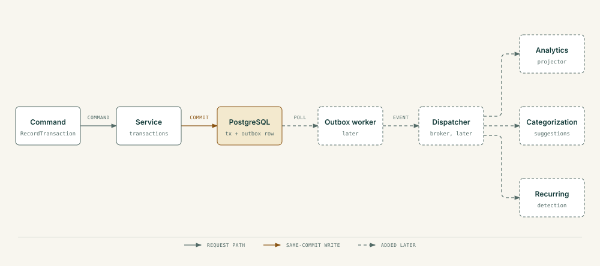
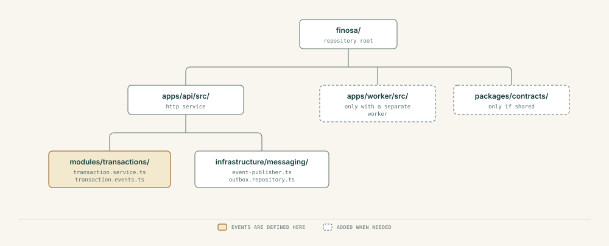

<div align="center">

# Event-Driven Design

Status: learning and implementation blueprint. The aim is to learn event-driven design (EDA) through real financial workflows, without adding distributed infrastructure before it is useful.

</div>

## 1. Core idea

An **event** records something that already happened: `transaction.recorded.v1`. A **command** asks for work: `RecordTransaction`. A **query** asks for data: `GetMonthlySpending`.

The part that emits an event is the **producer**. Parts that react are **consumers**. A **message broker** can carry events between processes. Events loosen coupling and allow asynchronous work, but they bring delayed updates, duplicate delivery and retry handling.

## 2. Where events help

After a transaction is recorded, independent reactions may include:

- recompute a monthly-spending projection;
- suggest a category (later);
- update recurring-payment candidates (later);
- evaluate alert rules (later);
- generate a grounded insight (later).

Correctness checks, authorization and the core database write stay inside the command's own transaction. Never defer them to an event.

<p align="center">
  
</p>

## 3. Learning stages

**A. Event contracts.** Define event names and payloads, and test when events should be produced. A TypeScript type alone delivers nothing.

**B. In-process events.** Use an `EventEmitter` or a local dispatcher to see publish and subscribe mechanics. Its limits: a crash can lose the event, a listener can fail, and nothing is persisted or retried. Never treat an in-memory event as proof that a financial side effect happened. This stage is for learning only.

**C. Transactional outbox.** Insert the transaction and an outbox record in one PostgreSQL transaction. A separate worker polls unprocessed records and dispatches them after commit. This fixes the dual-write failure where the database commit succeeds but publishing fails. It does not give exactly-once processing.

**D. Consumer reliability.** Store the processed `event_id` per consumer and make changes idempotent. Retry transient failures with backoff, and quarantine events that keep failing (also called dead-lettering). Handle a crash after the consumer did its work but before it acknowledged.

**E. Broker.** Compare RabbitMQ and Kafka against actual needs: routing, throughput, replay, ordering, operating effort, cost. Add one only if it solves or teaches something that a database-backed worker cannot.

**F. Observability.** Monitor outbox backlog, age of the oldest pending event, retry rate, poison messages, consumer lag and projection reconciliation. Then practice containerization and Kubernetes under a test workload.

## 4. Event catalog (proposed)

| Event | Emitted after | Possible consumer | MVP status |
|---|---|---|---|
| `transaction.recorded.v1` | A posted transaction is saved | Reports projector | First durable event |
| `transaction.updated.v1` | An allowed update is committed | Reports projector | When updates need projections |
| `transaction.voided.v1` | A void (the first half of a correction) is committed | Reports projector | With corrections |
| `import.completed.v1` | An import batch is committed | Import summary, metrics | Later |
| `category.changed.v1` | A user reclassifies a transaction | Analytics projector | Later |
| `recurring.detected.v1` | A detector confirms a candidate | Notifications | Later |
| `budget.threshold-crossed.v1` | An evaluator detects a crossing | Alerting | Later |

Name events in the past tense. Each one states a committed business fact, not a wish for work.

## 5. Envelope and privacy

```ts
export type TransactionRecordedV1 = {
  eventId: string;                    // UUID; globally unique
  eventType: 'transaction.recorded.v1';
  schemaVersion: 1;
  occurredAt: string;                 // ISO 8601 timestamp
  aggregateId: string;                // transaction ID
  aggregateVersion: number;           // for ordering/conflict detection
  correlationId: string;              // trace across a user workflow
  payload: {
    transactionId: string;
    userId: string;
    accountId: string;
  };
};
```

Keep payloads minimal. An event points to a record, and consumers fetch more through authorized internal data access. User identifiers are sensitive metadata, so restrict event access and redact identifiers in logs. Do not publish raw bank statement rows, credentials or full descriptions by default.

Version event types explicitly, document which fields are required, and keep old consumers working or plan their migration.

## 6. What the outbox protects

| Failure | Without outbox | With same-transaction outbox |
|---|---|---|
| Database transaction rolls back | An event may be published for data that never existed | Neither the transaction nor the outbox row persists |
| Database commits, app crashes before publishing | The event can be lost for good | The outbox row survives for the worker |
| Worker publishes, then crashes before marking delivered | May resend | Still may resend, so the consumer must be idempotent |

The target guarantee is durable at-least-once delivery combined with idempotent processing. Exactly-once execution across unrelated systems is not available.

## 7. Outbox schema (conceptual)

```text
outbox_events
  id UUID PRIMARY KEY
  event_type TEXT
  aggregate_id UUID
  aggregate_version INTEGER
  payload JSONB
  occurred_at TIMESTAMPTZ
  available_at TIMESTAMPTZ
  attempts INTEGER
  status TEXT   # pending / processing / delivered / quarantined
  last_error_code TEXT NULL
```

Worker algorithm:

1. Claim available rows safely under concurrency, for example with PostgreSQL `FOR UPDATE SKIP LOCKED` in short transactions, or with a lease.
2. Deliver to a handler or broker.
3. Mark delivered only after the downstream acknowledges.
4. On a transient failure, increment `attempts` and schedule a retry with capped exponential backoff and jitter.
5. On repeated or permanent failure, quarantine the row and alert. Keep enough metadata to replay it safely.

The lease and retry design must cover worker crashes and avoid rows stuck in `processing`. Do not hold a database lock during unbounded network calls.

## 8. Consumer idempotency

A consumer may see the same event more than once. Two common approaches:

- **Inbox table.** `UNIQUE (consumer_name, event_id)`, with the consumer's result and the processed marker written in the same database transaction.
- **Idempotent recompute.** Derive the projection from authoritative transaction state using stable identifiers, instead of adding `amount` each time a notification arrives.

Tests must show that replaying an event N times ends in the same state as processing it once. For external side effects such as push or email, use the provider's idempotency support or deduplication, and document the limits.

## 9. Ordering and replay

Do not assume a global event order. If order matters for an account or transaction, use an explicit aggregate version and make projection updates version-aware. Otherwise derive from authoritative state. Several workers can race.

If transactions can be edited or voided, a running `+amount` projection can go wrong. Prefer a per-transaction projection keyed by transaction ID, or rebuild totals from authoritative records. Replay means clearing and rebuilding derived projections. It never means re-applying the original ledger writes.

## 10. Failure drills

| Experiment | What it proves |
|---|---|
| Crash before database commit | No transaction and no outbox row |
| Crash after database commit | The outbox row survives and is dispatched later |
| Deliver twice | The consumer's outcome equals a single delivery |
| Kill the worker mid-processing | Lease and retry recovery works |
| Broker or consumer unavailable | Transaction capture keeps working and the outbox grows visibly within bounds |
| Malformed event | Quarantined with safe error metadata, with no endless crash loop |
| Out-of-order updates | The projection stays correct or detects the missing version |
| Replay all events | The rebuilt projection matches the authoritative totals |

## 11. RabbitMQ or Kafka

| Question | RabbitMQ often fits | Kafka often fits |
|---|---|---|
| Task delivery and routing? | Strong candidate | Possible, different model |
| Long-lived event log and replay? | Less native | Strong candidate |
| High-volume ordered partitions? | Can be configured | Strong candidate |
| Simple for a solo MVP? | Still overhead | Usually more overhead |

Current recommendation: neither on day one. Use a PostgreSQL outbox and worker first. Add a broker as a later milestone and record the choice in an ADR.

## 12. Folder boundaries (when implemented)

<p align="center">
  
</p>

## 13. Definition of done

- Event contracts are documented and versioned.
- The transaction and its outbox row are written atomically.
- Retries do not duplicate financial side effects.
- Failed events are recoverable and observable.
- Reconciliation confirms projections match source data.
- A developer can explain and reproduce every failure drill.
